# cheapGPT


## 1. Qué es cheapGPT
cheapGPT es el chat de servicio al cliente más barato del mercado: usa un LLM gratuito,
tiene tres humores (todos poco profesionales) y un sistema de reclamos que, con mucha suerte,
alguien lee. No lo deben construir desde cero, sino que lo reciben funcionando y lo deben dejar mejor de lo que lo
encontraron.

**Dudas:** cualquier duda relacionada con la misión (el setup, git, GitHub Desktop, los
refactorings, los conflictos, la entrega o lo que sea) pueden preguntarla en el foro de
preguntas de la tarea de la Misión 2 en Canvas.

## 2. Conceptos básicos

Antes de empezar, vean la [cápsula de git](https://cursos.canvas.uc.cl/courses/106170/files/folder/Misiones/M2?preview=16496283): ahí se explica con calma cómo
funciona todo esto. Lo que sigue es solo un resumen para consultar mientras trabajan.

- **Commit:** una "foto" de los cambios que hicieron, guardada en el historial con un
  mensaje que explica qué cambió (`git commit -m "mensaje"`).
- **Push:** subir sus commits locales a GitHub (`git push`), para que el resto los vea.
- **Pull:** traer a su computador los commits que otros subieron a GitHub (`git pull`).
- **`main`:** la rama principal del repo. En esta misión todos trabajan directo sobre ella.
- **Conflicto de merge:** pasa cuando dos personas cambian las mismas líneas de un archivo
  y git no sabe con cuál quedarse; alguien tiene que combinarlas a mano.
- **Code smell:** una señal de que el código está mal organizado aunque funcione (por
  ejemplo, una función demasiado larga o código repetido). Hace que sea difícil de leer y
  de modificar.
- **Refactoring:** cambiar cómo está escrito el código para eliminar un code smell,
  **sin cambiar lo que hace**. Si los tests pasaban antes, tienen que seguir pasando
  después.

## 3. Setup

**Antes de empezar**, cada integrante necesita:

- Una cuenta de GitHub.
- Git y Python 3.10 o superior instalados. Para revisar si ya los tienen, abran una
  terminal y escriban `git --version` y `python3 --version` (en Windows,
  `python --version`). Si no saben cómo abrir la terminal, o alguno de los dos comandos
  da error, sigan el [Anexo: instalar Python y Git](#12-anexo-instalar-python-y-git).
- Git conectado con su cuenta de GitHub, para poder subir sus cambios. Si nunca han
  subido nada a GitHub desde su computador, sigan el
  [Anexo: conectar git con GitHub](#13-anexo-conectar-git-con-github) (toma unos minutos).
  Si van a usar **GitHub Desktop**, no necesitan este anexo: lean primero el recuadro
  [Alternativa a la terminal](#alternativa-desktop) al final del setup.

1. **Crear el repo del grupo** (lo hace **un solo integrante**): entren a la página del
   repo plantilla, [ssya333/INF3220-M2](https://github.com/ssya333/INF3220-M2) (es el repo
   donde están leyendo esto), y hagan clic en **Use this template** → **Create a new
   repository**, arriba a la derecha. Elijan un nombre (por ejemplo, `cheapgpt`) y creen
   el repo.

   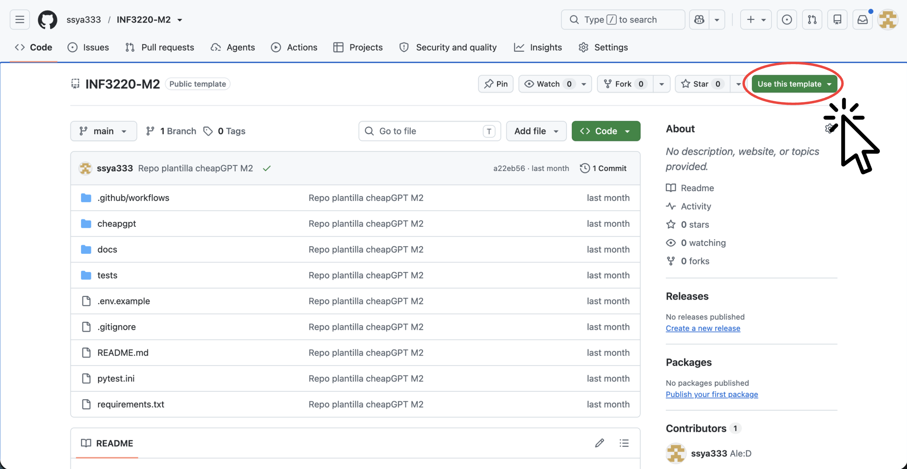

2. **Arreglar el badge del README** (el mismo integrante, apenas crea el repo). El badge
   es el ícono de tests que está al inicio de este archivo: muestra si los tests pasan o
   fallan en GitHub (ver [GitHub Actions](#5-github-actions)). Para que funcione, hay que
   cambiar un texto de relleno. Conviene hacerlo ahora, antes de agregar a los demás, para
   que cuando clonen el repo ya tengan el arreglo.

   El `README.md` es el archivo que GitHub muestra en la página principal del repo,
   debajo de la lista de archivos (este texto que están leyendo es el README del repo
   plantilla). En la página principal del repo **nuevo**:

   1. Hagan clic en el ícono del lápiz que está arriba a la derecha del README.

      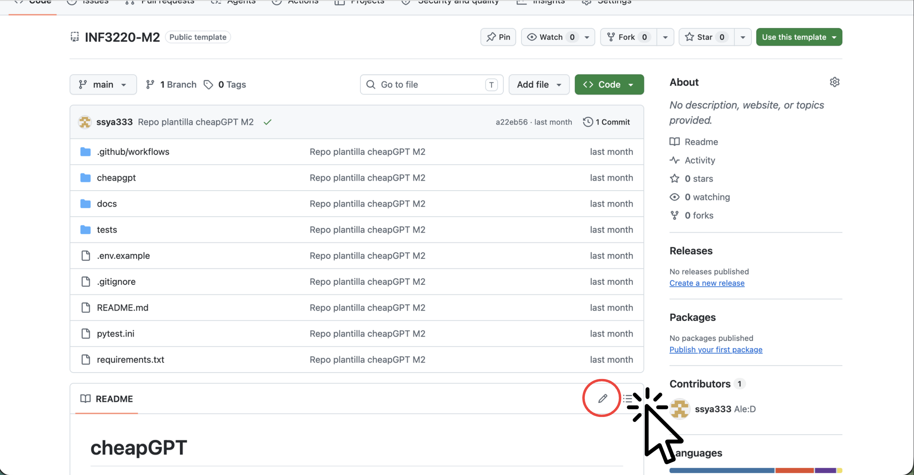

   2. Se abre un editor. En la línea 3 dice:
      ```
      
      ```
      Cambien `OWNER/REPO` por su usuario y el nombre del repo (por ejemplo,
      `mi-usuario/cheapgpt`).
   3. Hagan clic en **Commit changes** (botón verde arriba a la derecha) y confirmen.

3. **Agregar a los colaboradores** (el mismo integrante):

   1. En el repo **nuevo** del grupo, entren a **Settings** (en la barra de arriba).

      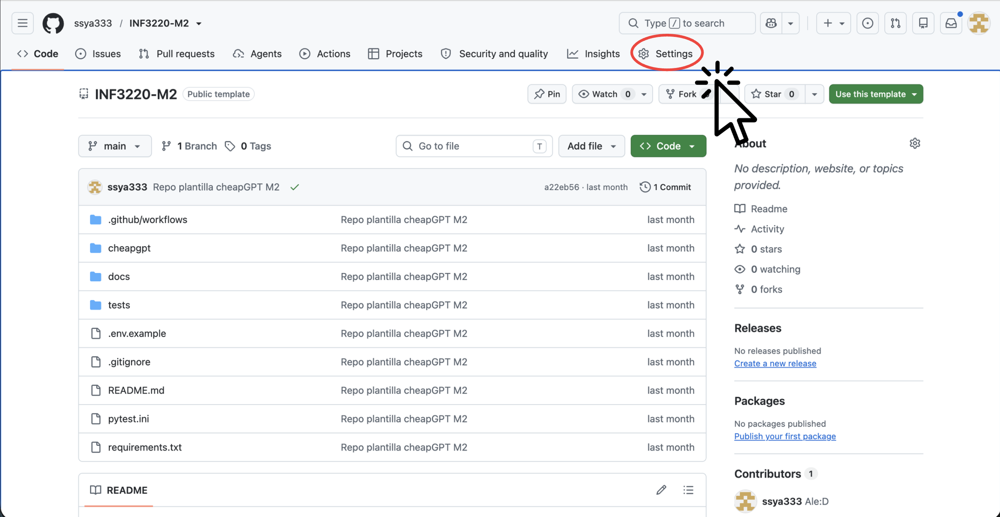

   2. En el menú de la izquierda, entren a **Collaborators**.

      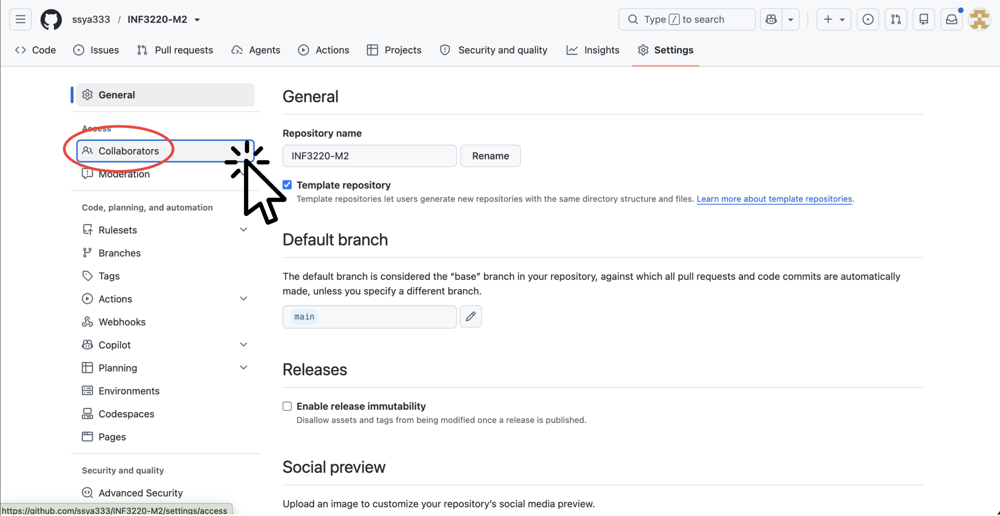

   3. Hagan clic en **Add people** y agreguen, uno por uno, a los otros dos integrantes y
      al usuario **`ssya333`** (equipo docente), que es quien revisa el repo. Cada persona
      tiene que **aceptar la invitación** que le llega por correo antes de poder tener
      acceso al repo. **Ojo: la invitación vence a los 7 días.** Si vence, quien creó el
      repo tiene que volver a invitarlos.

      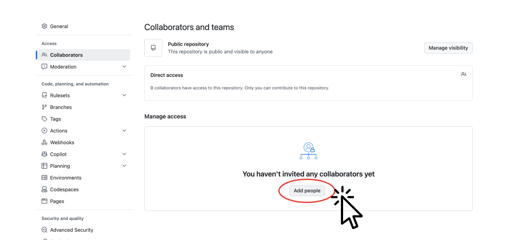

4. **Copiar la URL del repo del grupo** (cada integrante): en la página del repo del grupo,
   hagan clic en el botón verde **Code**…

   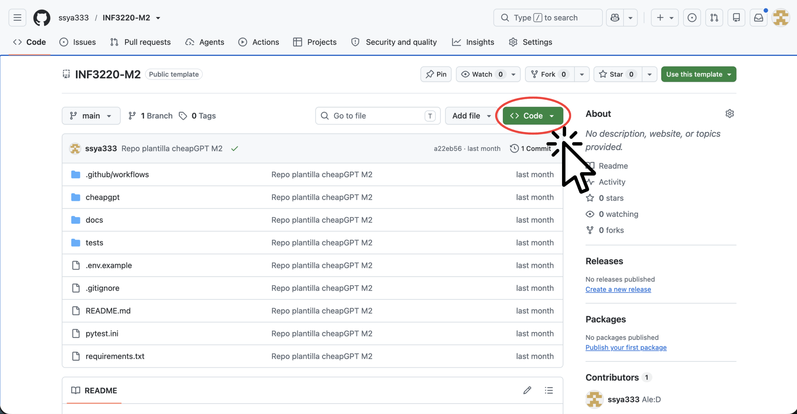

   …y, en la pestaña **HTTPS**, copien la URL con el ícono de copiar. En su repo va a
   aparecer su usuario y el nombre de su repo, no `ssya333/INF3220-M2` como en la imagen.

   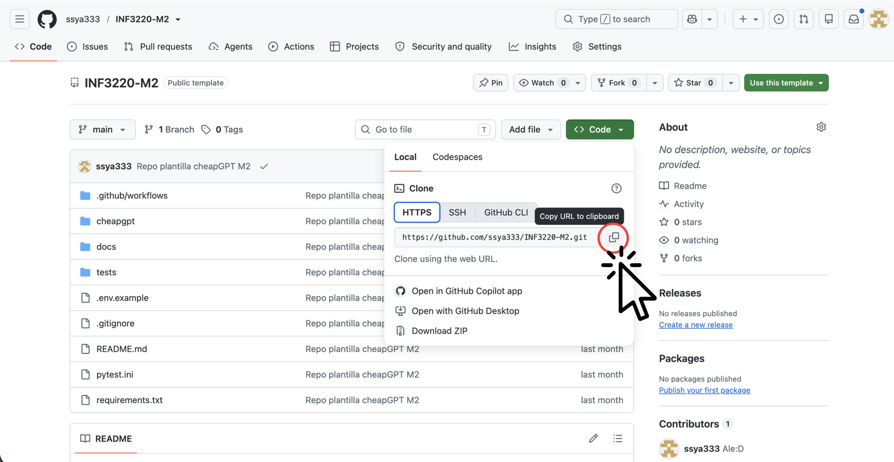

5. **Clonar y preparar el entorno** (cada integrante). Peguen la URL que copiaron en vez
   de `<url-del-repo-del-grupo>`:
   ```bash
   git clone <url-del-repo-del-grupo>
   cd <nombre-del-repo-del-grupo>
   python3 -m venv venv       # en Windows: python -m venv venv
   source venv/bin/activate   # en Windows: venv\Scripts\activate
   pip install -r requirements.txt
   ```
   Explicación: `git clone` descarga el repo a su computador; `cd` entra a la
   carpeta; `python3 -m venv venv` crea un entorno virtual (una carpeta `venv/` con un
   Python solo para este proyecto); `source ...activate` lo activa; y `pip install` instala
   ahí las librerías que usa cheapGPT, que están listadas en `requirements.txt` (entre
   ellas Flask, para correr la app, y pytest, para los tests). No hay que instalar nada más.

   De aquí en adelante, todos los comandos se corren dentro de la carpeta del repo y con
   el entorno activado. Para saber si está activado:
   - En la mayoría de las terminales aparece `(venv)` al inicio de la línea.
   - Si la suya no lo muestra, corran `which python` (en Windows: `where python`): si
     está activado, la primera ruta que aparece termina en `venv/bin/python` (en Windows,
     `venv\Scripts\python.exe`).

   El entorno queda activado solo en la terminal donde lo activaron. **Si abren una
   terminal nueva**, revisen si está activado y, si no, actívenlo de nuevo con
   `source venv/bin/activate` (en Windows: `venv\Scripts\activate`). La terminal de
   VS Code, si tienen instalada la extensión de Python, suele activarlo sola.

   **Si algo falla:**
   - **`python3 -m venv venv` da error** (`command not found`, `No module named venv` o
     `ensurepip is not available`): les falta Python o el módulo `venv`. Sigan el
     [Anexo: instalar Python y Git](#12-anexo-instalar-python-y-git).
   - **En Windows (PowerShell), `venv\Scripts\activate` dice que la ejecución de scripts
     está deshabilitada:** corran una vez
     `Set-ExecutionPolicy -Scope CurrentUser RemoteSigned`, contesten `S` (o `Y`) y
     vuelvan a activar el entorno.
   - **Al correr la app o los tests aparece `ModuleNotFoundError: No module named ...`**
     (por ejemplo, `dotenv` o `flask`): es casi seguro que el entorno **no está
     activado**. Actívenlo y vuelvan a intentar.
   - **Si su problema no está en esta lista, o nada de esto les funciona:** pregunten en
     el foro de preguntas de la tarea de la Misión 2 en Canvas, con un pantallazo del comando y del error, e indiquen su
     sistema operativo.
6. **Revisar que git sepa quiénes son** (cada integrante, dentro de la carpeta del repo):
   ```bash
   git config user.email
   ```
   GitHub asocia cada commit a una cuenta según este email, no según quién hace el push:
   así se ve quién hizo cada refactoring y quién resolvió cada conflicto. Si el comando no
   muestra nada, o muestra un email que no está en su cuenta de GitHub, configúrenlo. Hay
   dos opciones; elijan una:

   - **Solo para este repo** (dentro de la carpeta del repo):
     ```bash
     git config user.name "Tu Nombre"
     git config user.email "tu-email-de-github@ejemplo.com"
     ```
   - **Para todos los repos de su computador**, agregando `--global`. Así no tienen que
     volver a hacerlo en otros repos:
     ```bash
     git config --global user.name "Tu Nombre"
     git config --global user.email "tu-email-de-github@ejemplo.com"
     ```
7. **Configurar la estrategia de pull** (cada integrante, dentro de la carpeta del repo):
   ```bash
   git config pull.rebase false
   ```
   Cuando dos personas pushean en paralelo, git necesita saber cómo combinar los cambios
   al hacer `git pull`; si no se lo dicen, se detiene con el error `fatal: Need to specify
   how to reconcile divergent branches`. Con esta línea, `git pull` siempre hace
   **merge**, que es lo que van a resolver a mano en esta misión. Va sin `--global`, así
   que solo afecta a este repo.
8. **Correr la app** (Flask ya quedó instalado en el paso 5):
   ```bash
   flask --app cheapgpt.app run --port 5050
   ```
   Abran `http://127.0.0.1:5050` y prueben el chat, `/planes`, `/reclamo` y `/excusas`.
9. **Correr los tests** (pytest también quedó instalado en el paso 5):
   ```bash
   pytest
   ```
   Al final deberían ver `79 passed`. **Todos los tests tienen que pasar**, ahora y antes
   de cada push. Si alguno falla antes de que hayan cambiado nada, revisen que el entorno
   esté activado (ver paso 5); si sigue fallando, pregunten en
   el foro de preguntas de la tarea de la Misión 2 en Canvas.
10. **API key opcional**: si quieren que el bot use un LLM de verdad (Groq, gratis),
   sigan estos pasos. Sin key, la app funciona igual con un bot falso (`FakeLLMClient`)
   que responde con frases fijas. (No hace falta esto para entregar la misión).

   1. Creen una cuenta gratis en [console.groq.com](https://console.groq.com) (no pide
      tarjeta) y generen una API key en **API Keys → Create API Key**.
   2. Copien `.env.example` a `.env`:
      ```bash
      cp .env.example .env       # en Windows: copy .env.example .env
      ```
   3. Peguen su key en `.env`:
      ```
      GROQ_API_KEY=gsk-tu_key_aca
      ```
   4. Reinicien la app (`Ctrl+C` y vuelvan a correr `flask --app cheapgpt.app run --port 5050`) y
      prueben el chat. Si la key es válida, las respuestas ya no van a ser siempre las
      mismas 3 frases del bot falso, sino texto generado por el modelo.
   5. **Nunca comiteen su `.env` ni su key** (ya está en `.gitignore`, pero revisen con
      `git status` antes de cada commit).

<a id="alternativa-desktop"></a>

> **Alternativa a la terminal: GitHub Desktop.** Con el entorno ya instalado, el resto de
> la misión pueden trabajarlo con **GitHub Desktop**, un programa oficial de GitHub que
> permite hacer con botones, sin escribir comandos de git: **commit**, **push**, **pull**,
> ver qué archivos cambiaron, ver el historial y **resolver conflictos** abriéndolos
> directo en VS Code. La terminal se sigue necesitando para correr `pytest` y la app. Es
> opcional y gratis, pero **hay que descargarlo e instalarlo** desde
> [desktop.github.com](https://desktop.github.com). Cómo instalarlo y usarlo está en el
> [Anexo: usar GitHub Desktop](#14-anexo-usar-github-desktop-en-vez-de-la-terminal).
>
> Si deciden usarlo **desde el principio**, se ahorran pasos del setup, porque GitHub
> Desktop inicia sesión con su cuenta solo:
> - No necesitan el [Anexo: conectar git con GitHub](#13-anexo-conectar-git-con-github)
>   (GitHub CLI).
> - En el paso 5, clonan con el botón **Open with GitHub Desktop** en vez de `git clone`
>   y `cd`, y en la terminal corren solo los comandos del entorno.
> - Se saltan el paso 6 (nombre y email), porque GitHub Desktop se los pide al iniciar
>   sesión.
> - Se saltan el paso 7 (`git config pull.rebase false`), porque GitHub Desktop ya hace
>   merge al hacer pull.
>
> El resto de los pasos (1 a 4 y 8 a 10) son iguales. El detalle está en la parte 3 del anexo.

## 4. Reglas

- **Prohibido modificar la carpeta `tests/`.**
- Corran `pytest` antes de cada push. Todos los tests tienen que pasar.
- No cambien el comportamiento del código, solo su estructura interna.

## 5. GitHub Actions

GitHub Actions es un servicio de GitHub que corre los tests automáticamente. Este repo
ya viene configurado: **cada vez que alguien hace push**, GitHub corre `pytest` en sus
servidores (tarda uno o dos minutos) y muestra el resultado:

- Un **check verde** (✓) significa que todos los tests pasan.
- Uno **rojo** (✗) significa que algo se rompió; típicamente, un refactoring que cambió
  el comportamiento o un merge mal resuelto.

Dónde verlo:
- En la página principal del repo, al lado del último commit (arriba de la lista de
  archivos), aparece el ✓ o la ✗.
- En la pestaña **Actions** del repo (en la barra de arriba, junto a Issues y Settings)
  está la lista de todas las ejecuciones; hagan clic en una para ver el detalle y qué
  test falló.
- El badge del README también muestra si el último resultado fue verde o rojo.

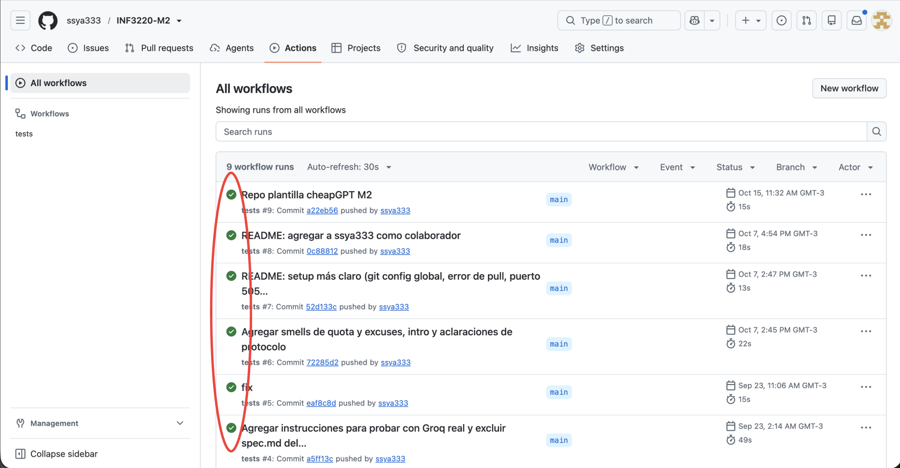

**Revísenlo después de cada push**, y antes de empezar la ronda 2: la ronda 2 empieza
recién cuando el último push de la ronda 1 está en verde.

## 6. Advertencia: vamos a pushear directo a `main`

En esta misión van a hacer **push directo a `main`, sin pull requests ni revisión**.
Esto **es una mala práctica** y lo hacemos a propósito, con fines pedagógicos:

- Cualquier error de alguien rompe `main` para todo el equipo.
- Nadie revisa el código antes de que llegue a la rama principal.
- Los conflictos de merge se resuelven a medida que aparecen, sin aviso previo.

En la **Misión 3** van a aprender a trabajar con git flow (ramas, pull requests, revisión
de código) para evitar exactamente estos problemas.

## 7. Roles

Cada grupo de 3 se asigna los roles **A**, **B** y **C**. Cada persona hace 2 de los 6
refactorings (uno en la ronda 1, otro en la ronda 2).

## 8. Ronda 1 y ronda 2

**Ronda 1** — orden de push **A → B → C**:

1. Al inicio de la ronda, los tres hacen `git pull`.
2. Trabajan en paralelo en su refactoring.
3. Pushean en el orden indicado: primero A, después B, después C.
4. Si el push es rechazado (`! [rejected] ... (fetch first)`), hagan `git pull --no-edit`
   y sigan el tutorial en [`docs/merge-conflicts.md`](docs/merge-conflicts.md).

Si usan GitHub Desktop, los botones equivalentes están en el
[Anexo: usar GitHub Desktop](#14-anexo-usar-github-desktop-en-vez-de-la-terminal).

> **Importante:** después del `git pull` del inicio de la ronda, **no vuelvan a hacer
> `git pull` hasta que les toque pushear y su push sea rechazado**. Si hacen pull antes de
> su turno, se saltan el conflicto que tienen que resolver, y eso cuenta como falta a las
> instrucciones.

**Ronda 2** — orden de push **B → C → A**:

Empieza recién cuando los tres pushes de la ronda 1 están en `main` y el check de
**Actions** está en verde (ver [GitHub Actions](#5-github-actions)). Mismo
procedimiento: `git pull` al inicio, trabajo en paralelo, push en el orden indicado.

El orden de push es fijo porque es lo que determina **quién se encuentra con el trabajo
de quién**: el que pushea último es siempre el que tiene que combinar su cambio con los
de los dos anteriores.

## 9. Los 6 refactorings

A cada grupo se le asignarán los code smells correspondientes a cada rol y ronda. Cada
refactoring se identifica con un código formado por el rol y la ronda: por ejemplo,
**A1** es el refactoring que hace el rol A en la ronda 1, y **C2** el que hace el rol C en
la ronda 2.

Cuando agreguen a `ssya333` como colaborador, el equipo docente va a publicar la
asignación de su grupo en un **issue** de su repo (pestaña **Issues**), en una tabla con
el siguiente formato, ordenada según el orden de push de cada ronda. La tabla de abajo es
solo un ejemplo del formato:

| Código | Archivo | Función | Smell | Por qué molesta |
|---|---|---|---|---|
| A1 | `cheapgpt/.../archivo.py` | `nombre_funcion` | Nombre del smell | Explicación breve del problema que genera. |
| B1 | ... | ... | ... | ... |
| C1 | ... | ... | ... | ... |
| B2 | ... | ... | ... | ... |
| C2 | ... | ... | ... | ... |
| A2 | ... | ... | ... | ... |

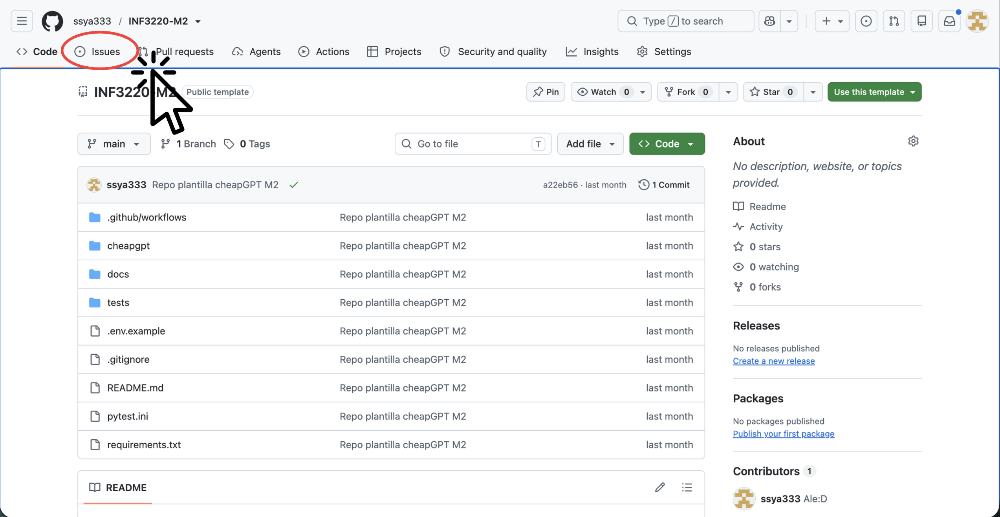

En la misma issue va el **código para aplicar cada refactoring**, paso a paso (qué
función reemplazar y por qué código), así que no necesitan saber programar en Python para
hacerlo. Cada uno aplica solo su código, en su turno. El foco de esta misión no es
inventar el refactoring, sino **trabajar en equipo**: respetar el orden de push, resolver
los conflictos combinando el trabajo de todos y mantener los tests en verde. Si les
interesa, lean el código antes de pegarlo y comparen con la tabla para entender qué
problema resuelve.

> **Importante:** varios refactorings tocan el mismo archivo o la misma función. Esto es
> intencional: así se generan los conflictos de merge que tendrán que resolver.

## 10. Resolución de conflictos

Cuando un push sea rechazado, van a tener que hacer `git pull --no-edit` y resolver el
conflicto a mano. Sigan el tutorial paso a paso en [`docs/merge-conflicts.md`](docs/merge-conflicts.md), tiene un ejemplo real sacado de este mismo repo.

`--no-edit` evita que git abra un editor para escribir el mensaje del merge. Si
`git pull --no-edit` no muestra ningún `CONFLICT`, es porque cambiaron partes distintas
del código y git juntó todo solo: corran `pytest` y, si pasa, hagan `git push`.

Para resolver un conflicto, **hablen con el compañero cuyo cambio chocó con el suyo**:
pregúntenle qué cambió y revisen juntos el código de los dos en la issue. Resolver un
conflicto **no es elegir un lado**: el resultado tiene que conservar **todos**
los refactorings involucrados, combinados. Si al resolver se descarta el refactoring de un
compañero, ese refactoring se considera no aplicado. Antes de commitear el merge:
no puede quedar ningún marcador (`<<<<<<<`, `=======`, `>>>>>>>`) y `pytest` tiene que pasar.

## 11. Entregable

Se evalúa **el repo del grupo**, tal como quedó en `main` a la fecha de entrega: el
código, el historial de commits y los checks de Actions. No hay informe.

1. **Link del repo:** un integrante sube el link del repo del grupo en Canvas, en la
   tarea de la Misión 2.
2. **Acceso:** el usuario `ssya333` tiene que estar agregado como colaborador desde el
   inicio (paso 3 del setup), sea el repo público o privado.
3. **Estado final:** en `main` están los 6 refactorings, sin marcadores de conflicto, y el
   último check de Actions está en verde.
4. **Historial:** se revisa el historial para ver cada refactoring, el orden de
   push y cada resolución de conflicto. No usen `git push --force`, `git rebase` ni
   squash, y no borren ni reescriban commits.
5. **Nada después de la fecha:** se evalúa el último commit de `main` anterior a la fecha
   de entrega (o de atraso, si corresponde).

## 12. Anexo: instalar Python y Git

**1. Abrir una terminal.** La terminal es la ventana donde se escriben los comandos de
este enunciado.

- **macOS:** presionen `Cmd + Espacio`, escriban **Terminal** y presionen Enter.
- **Windows:** abran el menú Inicio, escriban **PowerShell** y ábranlo. Una vez que
  instalen Git, también pueden usar **Git Bash**.
- **Linux:** presionen `Ctrl + Alt + T`.
- **VS Code** (o el editor que usen) también trae una terminal. En VS Code, con el
  proyecto abierto, usen el menú **Terminal → New Terminal** (en Mac, el menú está en la
  barra de arriba de la pantalla; en Windows y Linux, arriba de la ventana de VS Code).
  Si no lo encuentran, sirve **View → Terminal** o el atajo ``Ctrl + ` `` (puede cambiar
  según el teclado).

**2. Revisar si ya tienen Git y Python.** En la terminal, escriban cada línea y presionen
Enter:

```bash
git --version
python3 --version     # en Windows: python --version
```

Si los tienen, van a ver algo como esto (los números pueden ser otros):

```
git version 2.39.5
Python 3.12.4
```

Si ambos muestran una versión, y la de Python es 3.10 o superior, no tienen que
instalar nada. Si alguno dice `command not found`, `no se reconoce como un comando` o
muestra una versión de Python más antigua, sigan los pasos de su sistema operativo:

**macOS**

1. Git: corran `xcode-select --install` en la terminal y acepten la instalación.
2. Python: descarguen el instalador de [python.org/downloads](https://www.python.org/downloads/)
   y ábranlo. Viene con `venv` incluido (`venv` es la herramienta de Python para crear el
   entorno virtual del paso 5 del setup).

**Windows**

1. Git: descarguen e instalen [Git for Windows](https://git-scm.com/download/win) con las
   opciones por defecto. Trae **Git Bash**, una terminal para Windows que acepta los
   mismos comandos que la de macOS y Linux. Pueden usarla en vez de PowerShell.
2. Python: descarguen el instalador de [python.org/downloads](https://www.python.org/downloads/).
   En la primera pantalla del instalador, **marquen la casilla "Add python.exe to PATH"**
   antes de hacer click en *Install Now*.
3. En Windows el comando es `python` en vez de `python3`.

**Linux (Ubuntu/Debian)**

```bash
sudo apt update
sudo apt install git python3 python3-venv
```
En Ubuntu, `venv` viene en un paquete aparte (`python3-venv`): si `python3 -m venv venv`
da error, es porque falta ese paquete.

Después de instalar, **cierren y vuelvan a abrir la terminal** y revisen de nuevo las
versiones. Si sigue dando error, pregunten en el foro de preguntas de la tarea de la Misión 2 en Canvas, con un pantallazo del
comando y del error, indicando su sistema operativo.

## 13. Anexo: conectar git con GitHub

GitHub no deja subir cambios (`git push`) con la contraseña de su cuenta: si lo intentan,
falla con `Password authentication is not supported`. O sea, sin este paso **no van a
poder hacer push** (y si el repo es privado, tampoco `git clone`). La forma más simple de
conectar git con su cuenta es con **GitHub CLI**, un programa oficial de GitHub. Se hace
una sola vez por computador.

Si ya han hecho push a GitHub desde su computador, ya está conectado y pueden saltarse
este anexo. Si van a usar GitHub Desktop, tampoco lo necesitan: GitHub Desktop inicia
sesión solo (ver [Anexo: usar GitHub Desktop](#14-anexo-usar-github-desktop-en-vez-de-la-terminal)). En Windows, Git for Windows a veces abre el navegador para iniciar sesión la
primera vez que hacen push; si eso les funciona, tampoco necesitan este anexo.

**1. Instalar GitHub CLI.**

- **macOS y Windows:** descarguen el instalador desde [cli.github.com](https://cli.github.com)
  (botón *Download*) y ábranlo.
- **Linux:** sigan las instrucciones de
  [instalación para Linux](https://github.com/cli/cli/blob/trunk/docs/install_linux.md).

Cierren y vuelvan a abrir la terminal, y revisen que quedó instalado con `gh --version`.

**2. Iniciar sesión.** En la terminal, corran:

```bash
gh auth login
```

Les va a hacer unas preguntas. Muévanse con las flechas y elijan con Enter:

| Pregunta | Respuesta |
|---|---|
| Where do you use GitHub? | **GitHub.com** |
| What is your preferred protocol for Git operations? | **HTTPS** |
| Authenticate Git with your GitHub credentials? | **Yes** |
| How would you like to authenticate GitHub CLI? | **Login with a web browser** |

Después les muestra un código (algo como `ABCD-1234`). Cópienlo, presionen Enter, y en el navegador
que se abre peguen el código y autoricen.

**3. Revisar que funcionó.** Corran:

```bash
gh auth status
```

Si dice `Logged in to github.com account <su-usuario>`, ya pueden hacer `git clone` y
`git push` sin que les pida contraseña.

## 14. Anexo: usar GitHub Desktop en vez de la terminal

**GitHub Desktop** es un programa oficial de GitHub que permite clonar, hacer commit, push y
pull con botones, sin escribir comandos de git. Es **opcional**: hace exactamente lo mismo
que los comandos de este enunciado, y en un mismo grupo unos pueden usar la terminal y otros
GitHub Desktop.

**Ojo:** GitHub Desktop solo reemplaza los comandos de **git**. El entorno virtual, la app
(`flask ...`) y los tests (`pytest`) se siguen corriendo en la terminal.

### 1. Descargar e iniciar sesión

1. Descarguen GitHub Desktop desde [desktop.github.com](https://desktop.github.com),
   instálenlo y ábranlo.
2. En la pantalla de bienvenida, hagan clic en **Sign in to GitHub.com**. Se abre el
   navegador: autoricen con su cuenta de GitHub y acepten volver a GitHub Desktop.

   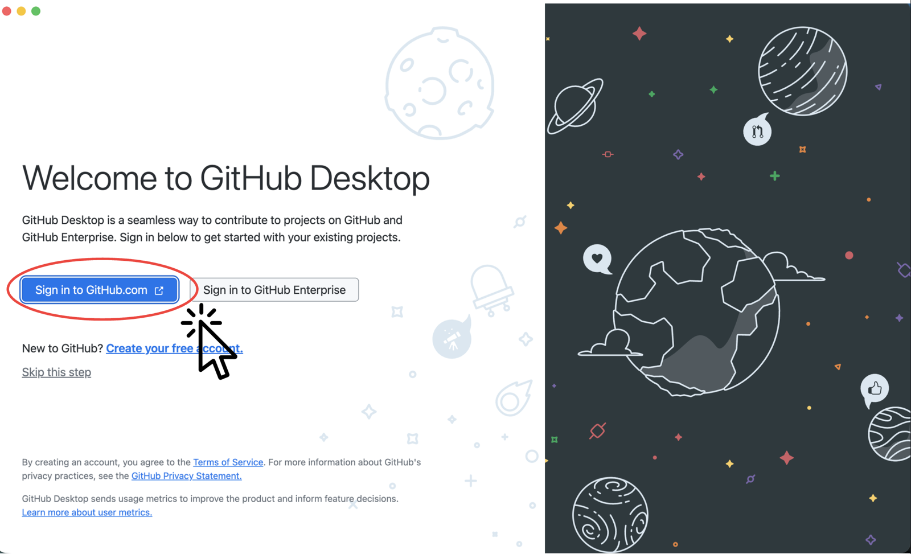

3. En **Configure Git**, dejen marcado **Use my GitHub account name and email address** y
   hagan clic en **Finish**. Esto reemplaza el paso 6 del setup.

   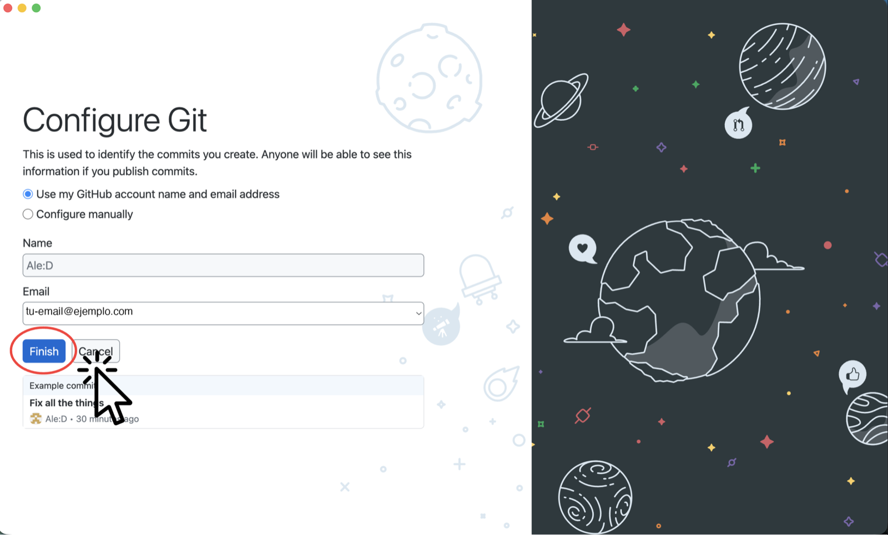

Con esto, GitHub Desktop ya queda conectado a su cuenta y **no necesitan el
[Anexo: conectar git con GitHub](#13-anexo-conectar-git-con-github)**.

### 2. Qué botón hace lo mismo que cada comando

| En la terminal | En GitHub Desktop |
|---|---|
| `git clone <url>` | En la página del repo, botón verde **Code** → **Open with GitHub Desktop** → **Clone**. |
| Abrir el proyecto en VS Code | Botón **Open in Visual Studio Code** (o menú **Repository → Open in Visual Studio Code**). |
| Abrir una terminal en la carpeta del repo (`cd ...`) | Menú **Repository → Open in Terminal**. |
| `git status` | Pestaña **Changes** (a la izquierda): los archivos modificados y las líneas que cambiaron. |
| `git add` + `git commit -m "mensaje"` | En **Changes**, escriban el mensaje en **Summary** y hagan clic en **Commit to main**. |
| `git push` | Botón **Push origin**. |
| `git pull` | Botón **Fetch origin** (revisa si hay cambios en GitHub) y después **Pull origin** (los trae). |
| `git merge --abort` | Botón **Abort Merge** de la ventana de conflictos. |
| `git log` | Pestaña **History**. |

### 3. El setup con GitHub Desktop

Si ya hicieron el setup con la terminal, no tienen que repetir nada: en GitHub Desktop
vayan a **File → Add local repository**, elijan la carpeta del repo y sigan con la
parte 4. Si todavía no lo hacen, los pasos 1 a 4 del setup son iguales, y el paso 5 cambia
así:

1. En la página del repo del grupo, hagan clic en el botón verde **Code** y después en
   **Open with GitHub Desktop**. El navegador les pregunta si quieren abrir GitHub
   Desktop: acepten.

   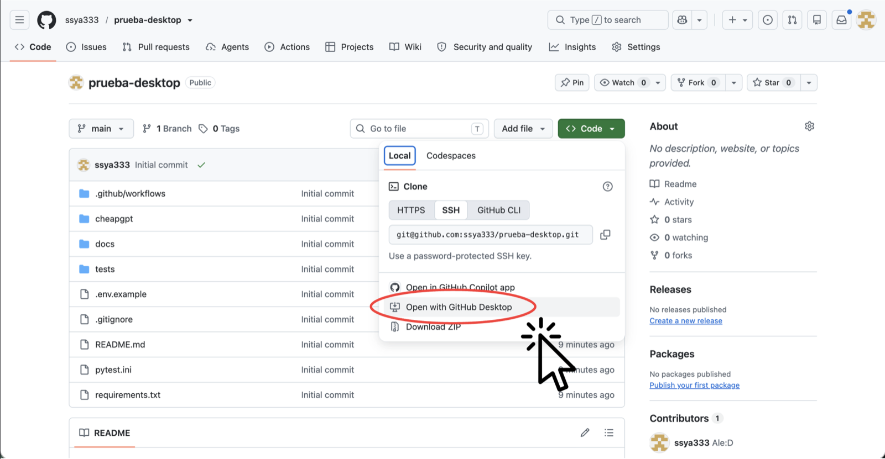

2. En GitHub Desktop se abre la ventana **Clone a Repository**. En **Local Path** está la
   carpeta donde se va a guardar el repo (pueden cambiarla con **Choose...**). Hagan clic
   en **Clone**.

   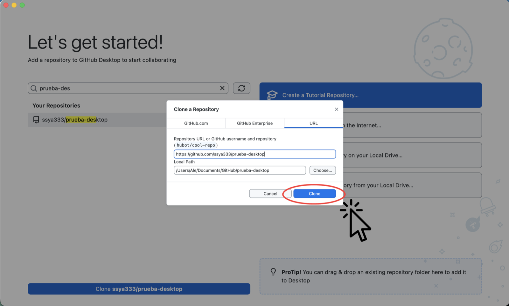

3. Abran una terminal en la carpeta del repo con **Repository → Open in Terminal** (o la
   terminal de VS Code, ver el punto siguiente) y corran solo los comandos del entorno, sin
   `git clone` ni `cd`:

   ```bash
   python3 -m venv venv       # en Windows: python -m venv venv
   source venv/bin/activate   # en Windows: venv\Scripts\activate
   pip install -r requirements.txt
   ```

4. Para abrir el proyecto en VS Code, usen el botón **Open in Visual Studio Code**. Si no
   aparece, elijan VS Code en **Settings → Integrations** (en Windows,
   **File → Options → Integrations**).

   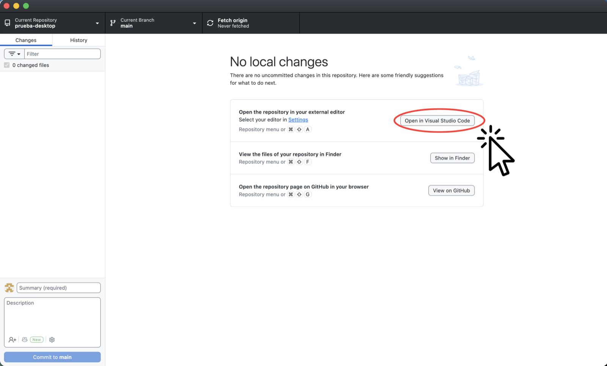

El paso 6 ya lo hicieron al iniciar sesión, y **el paso 7 no lo necesitan**: GitHub
Desktop ya combina los cambios con merge al hacer pull. Los pasos 8, 9 y 10 son iguales.

### 4. Las rondas con GitHub Desktop

Las reglas de la [sección 8](#8-ronda-1-y-ronda-2) no cambian.

**Al inicio de la ronda**, hagan clic en **Fetch origin** y, si aparece, en
**Pull origin**.

**Hacer su refactoring y el commit:**

1. Abran en VS Code el archivo que les toca (con **Open in Visual Studio Code**, como en
   la parte 3), hagan su refactoring y guarden.

   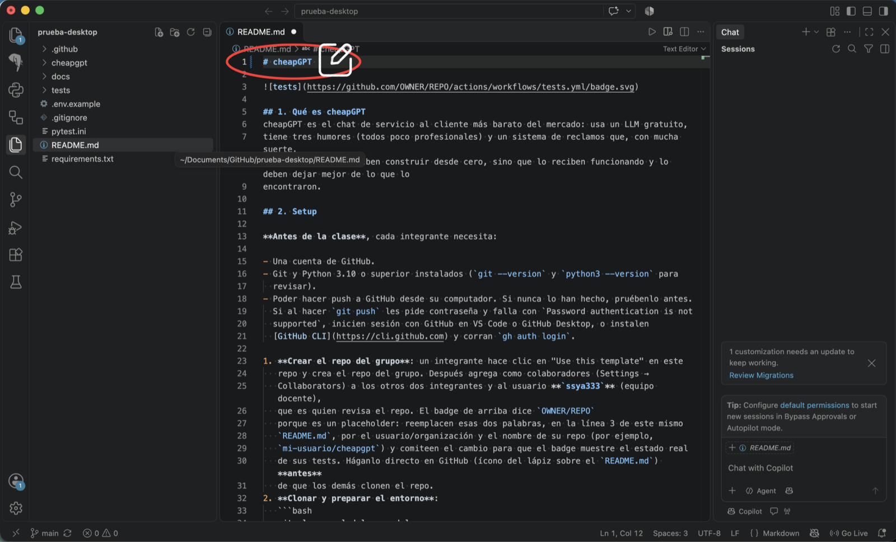

   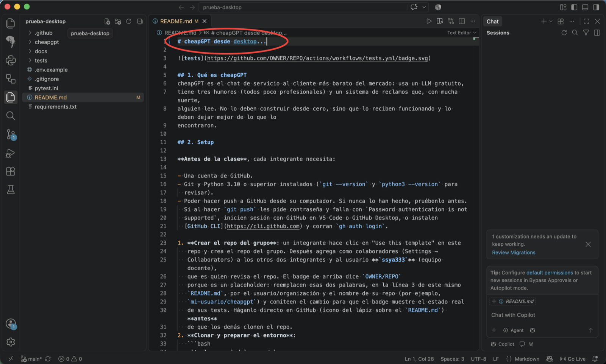

2. Corran `pytest` en la terminal. Todos los tests tienen que pasar.
3. Vuelvan a GitHub Desktop. En la pestaña **Changes** van a ver los archivos que
   cambiaron y, a la derecha, las líneas que cambiaron (en rojo lo que se borró, en verde
   lo que se agregó). Escriban un mensaje que explique el cambio en **Summary** (el campo
   de arriba; si lo dejan vacío, GitHub Desktop propone uno como `Update README.md`). Si
   quieren, agreguen más detalle en **Description**. Hagan clic en **Commit to main**.

   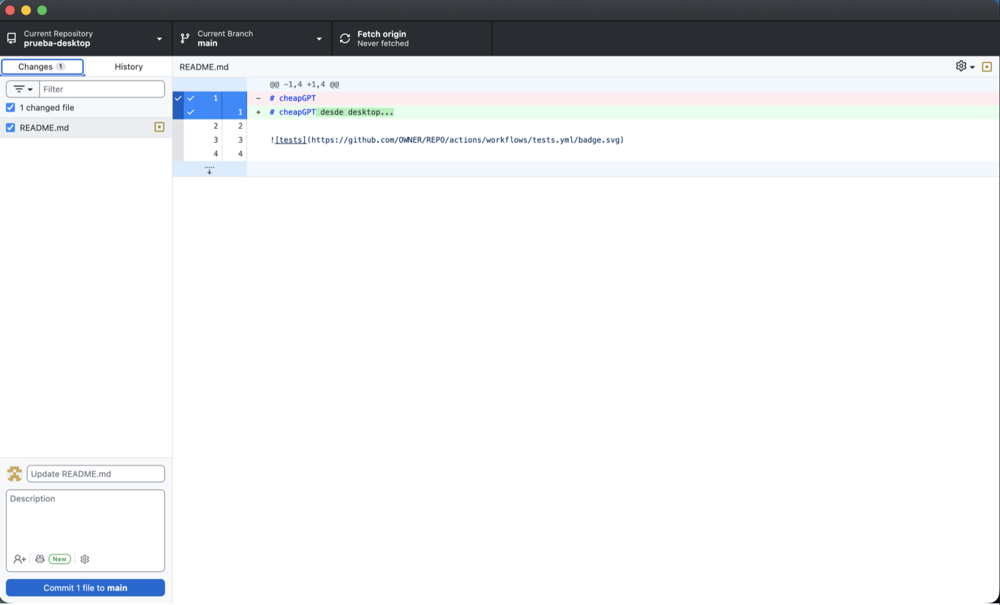

   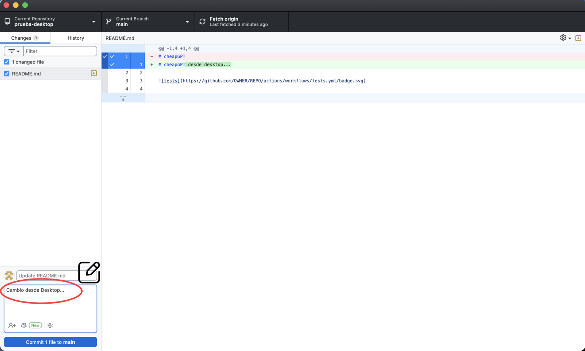

**Cuando sea su turno de push:**

4. Hagan clic en **Push origin** (arriba o en el centro de la ventana).

   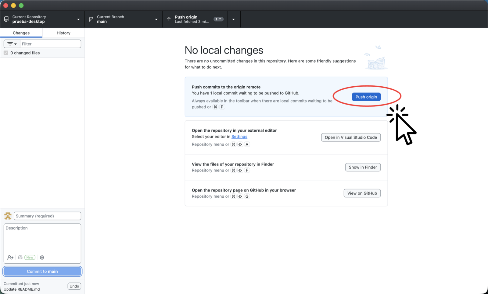

5. GitHub Desktop revisa GitHub cada cierto tiempo, así que cuando un compañero haga
   push, el botón de arriba puede cambiar solo a **Pull origin**. **No lo presionen**
   hasta que sea su turno y su push haya sido rechazado (misma regla que con `git pull`).

**Si un compañero pusheó antes (push rechazado):**

6. GitHub Desktop no los deja subir sus commits y muestra el aviso **Newer Commits on
   Remote**: es el mismo push rechazado de la terminal. Hagan clic en **Fetch**.

   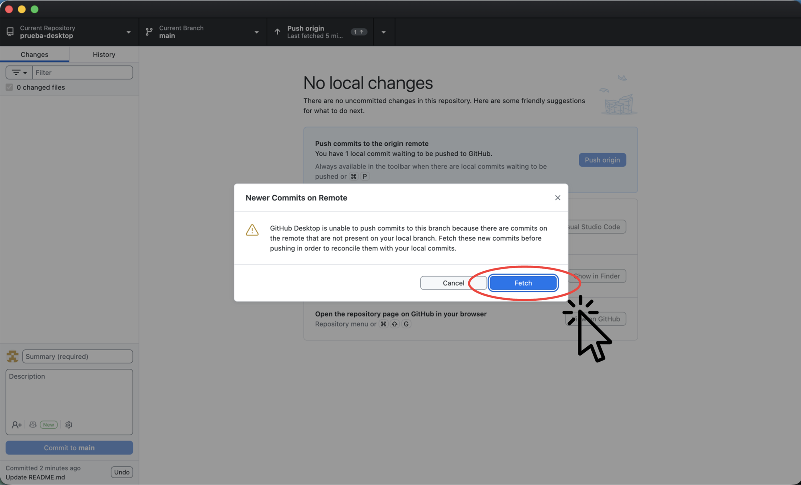

7. Ahora el botón dice **Pull origin**. Hagan clic.

   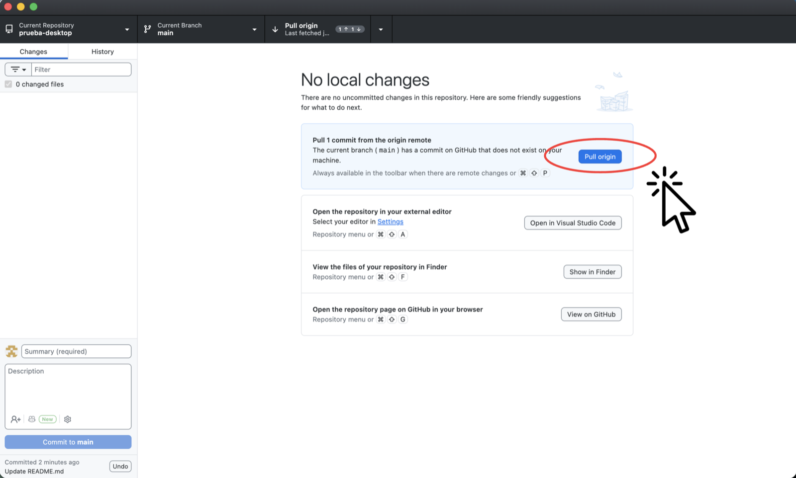

**Si hay conflicto:**

8. GitHub Desktop muestra la ventana **Resolve conflicts before Merge** con los archivos
   en conflicto. Para cada uno, hagan clic en **Open in Visual Studio Code**. No usen
   **Resolve with Copilot**: el conflicto lo tienen que resolver ustedes.

   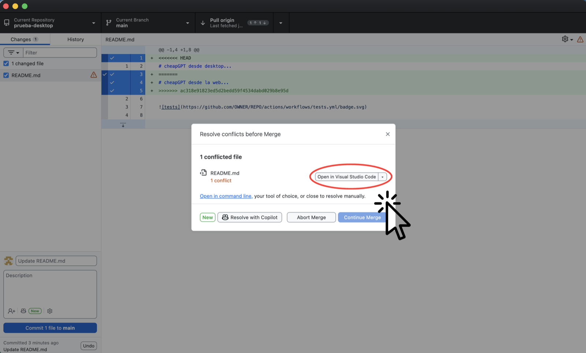

9. En VS Code van a ver los marcadores `<<<<<<<`, `=======` y `>>>>>>>`. Resuélvanlo
   como explica el [tutorial de conflictos](docs/merge-conflicts.md) (secciones 4 a 6):
   combinen ambos cambios y borren los marcadores. Guarden el archivo.

   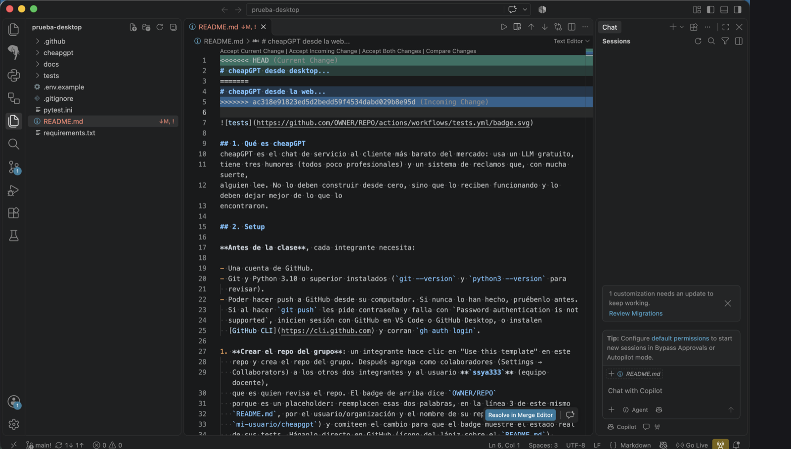

   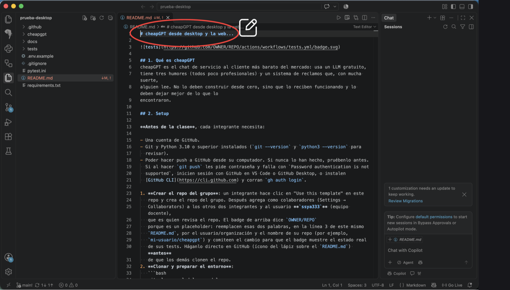

10. Corran `pytest` en la terminal. Si falla, sigan editando hasta que pase.
11. Vuelvan a GitHub Desktop. La ventana tiene que decir **All conflicted files have been
    resolved**. Hagan clic en **Continue Merge** (equivale a `git add` + `git commit`).

    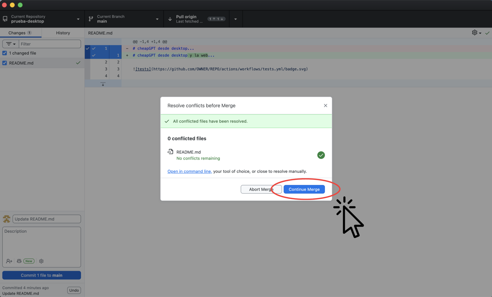

12. Hagan clic en **Push origin**. Ahora va a subir dos commits: el suyo y el del merge.

    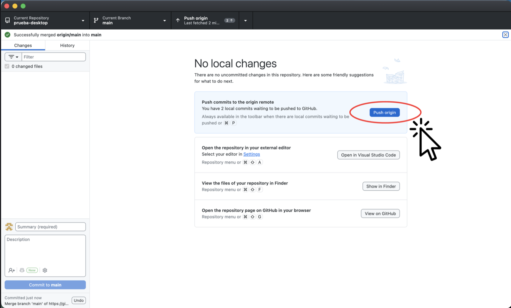

13. Revisen en GitHub que llegaron sus cambios y esperen el resultado de **Actions**
    (tarda uno o dos minutos después del push): tiene que quedar en **verde**. Si queda en
    rojo, el merge o algún refactoring rompió algo: entren a la pestaña **Actions** para
    ver qué test falló, arréglenlo, corran `pytest`, hagan commit y vuelvan a hacer push.
    **La ronda 2 no empieza, y la misión no está terminada, hasta que el último push esté
    en verde.**

    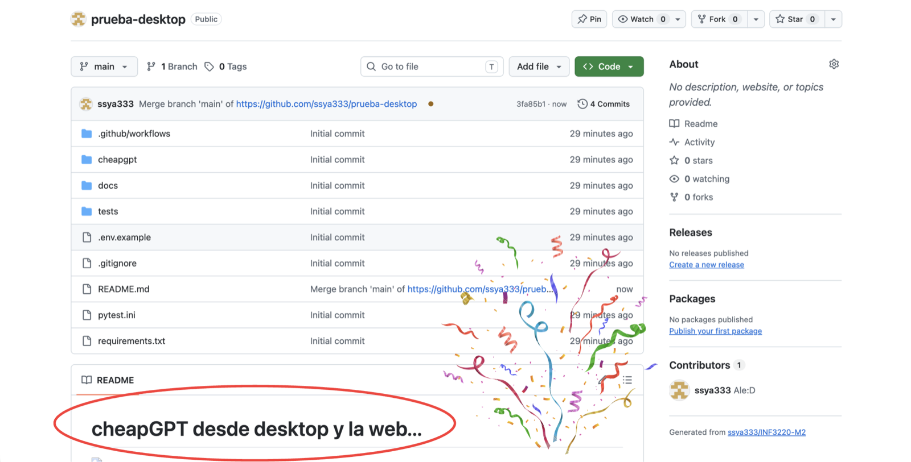

Si se pierden a mitad de camino, el botón **Abort Merge** de la ventana de conflictos
equivale a `git merge --abort`: los deja como estaban antes del pull.
